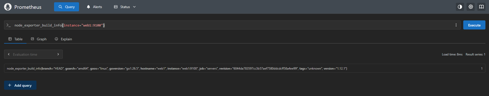
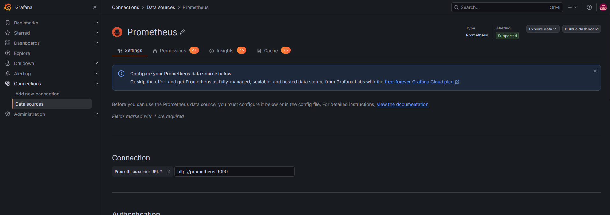
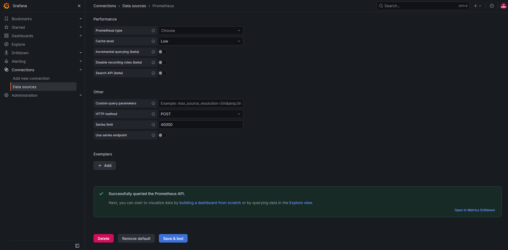
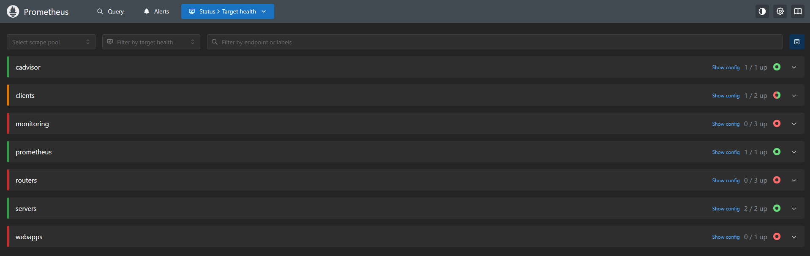
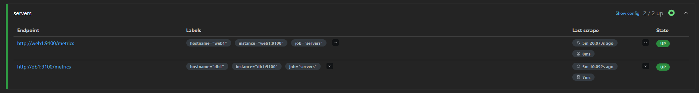
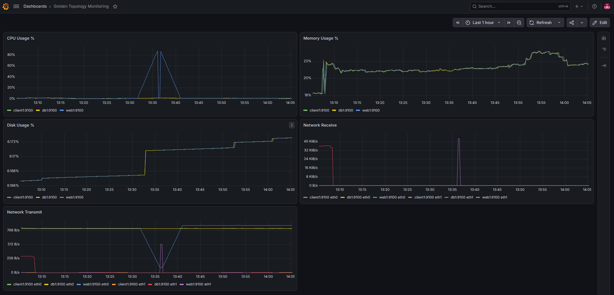
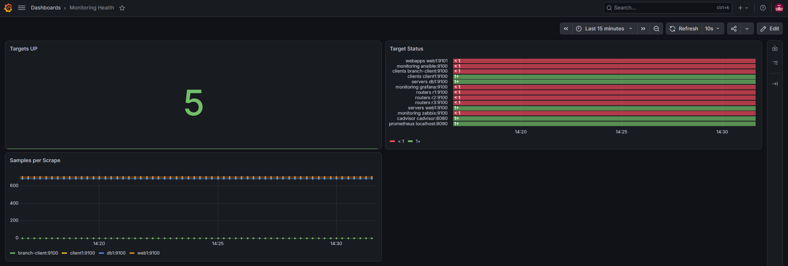
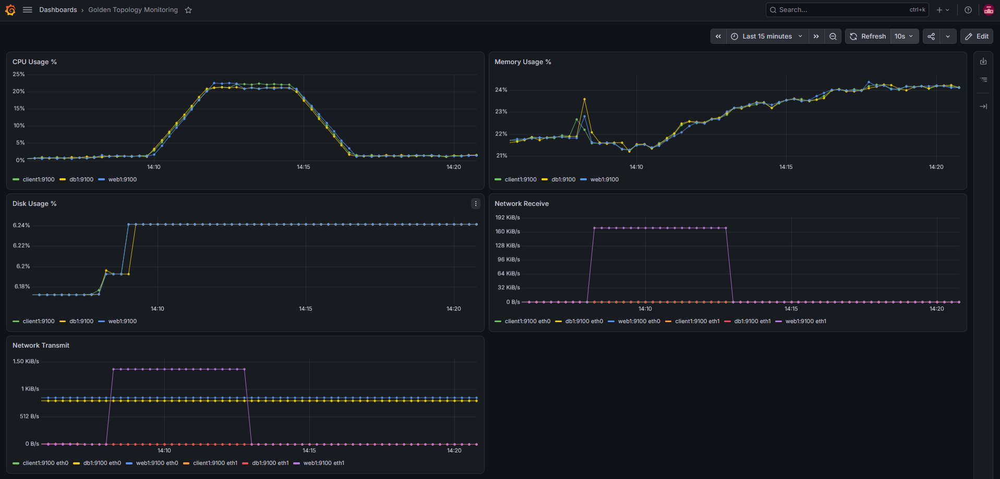
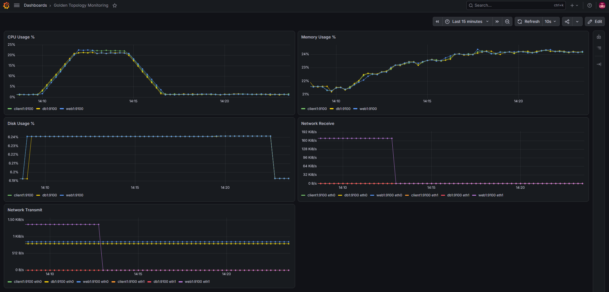

# Viikko 3: Palveluiden monitorointi Prometheuksella

## 1. Johdanto

**Mitä monitorointi tarkoittaa?**
Monitorointi on järjestelmien tilan jatkuvaa ja automaattista seurantaa. Palvelimilta ja palveluilta kerätään mittareita (esim. CPU, muisti, levy, verkko) säännöllisin väliajoin. Tavoitteena ei ole kerätä kaikkea mahdollista dataa, vaan havaita poikkeamat ja muutokset ajoissa.

**Miksi monitorointi on tärkeää?**
Pelkkä tieto siitä, että palvelu on käynnissä, ei riitä. Ylläpitäjän pitää tietää, miten hyvin palvelu toimii ja onko kuormitus muuttumassa ongelmaksi. Ilman monitorointia ongelma huomataan usein vasta käyttäjän valituksesta. Historiadatan avulla nykytilaa voidaan verrata normaalitasoon ja häiriön syytä voidaan selvittää jälkikäteen.

**Mikä on Prometheus?**
Prometheus on avoimen lähdekoodin monitorointijärjestelmä, joka kerää mittareita ja tallentaa ne aikasarjatietokantaan. Se toimii pull-mallilla: Prometheus hakee (scrape) mittarit säännöllisesti kohteiden HTTP-rajapinnasta `/metrics`. Kohteissa toimivat exporterit, jotka muuttavat järjestelmän tilatiedot Prometheuksen ymmärtämään muotoon. Tallennettua dataa kysellään PromQL-kielellä ja Grafana visualisoi kyselyjen tulokset.

Tietovirta tässä ympäristössä:

```text
Linux (web1, db1, client1) -> Node Exporter :9100 /metrics -> Prometheus (scrape 15 s + TSDB) -> PromQL -> Grafana
```

## 2. Ympäristön rakentaminen

**Mitkä palvelut ovat käytössä?**
Kurssin Containerlab-topologia sisältää valmiiksi Prometheuksen (`localhost:9090`), Grafanan (`localhost:3000`) ja cAdvisorin. Itse asensin web1-palvelimelle Node Exporterin uusimman version.

**Miten ympäristö käynnistettiin?**

```bash
cd ~/Verkonhallinta
bash scripts/deploy.sh
```

Käynnistys keskeytyi ensin, koska `deploy.sh` yrittää ajaa `chmod -R 777` -komennon kansioille `state/management/*`. Prometheus-, Grafana- ja Zabbix-kontit olivat edellisellä kerralla luoneet sinne tiedostoja omilla käyttäjätunnuksillaan, eikä tavallinen käyttäjä voi muuttaa niiden oikeuksia. Koska skriptissä on `set -e`, ensimmäinen virhe lopetti koko skriptin. Korjaus:

```bash
sudo chown -R janne:janne state/management/prometheus-data state/management/grafana-data state/management/zabbix-mysql state/management/zabbix-data
bash scripts/deploy.sh
```

**Node Exporterin asennus web1:lle ja konfiguraatiomuutokset**

Ennen asennusta tarkistin, oliko portti 9100 jo käytössä. Node Exporter oli jo asennettu ja käynnissä, koska labran käynnistysskripti asentaa sen automaattisesti:

```text
LISTEN 0 4096 *:9100 *:* users:(("node_exporter",pid=447,fd=3))
/opt/node_exporter/node_exporter
node_exporter, version 1.8.2
```

Uusin versio GitHubissa oli `v1.12.1`. Pysäytin valmiiksi asennetun version ja asensin uusimman käsin tehtävänannon mukaisesti:

```bash
kill 447
cd /root
apt install wget tar -y
wget https://github.com/prometheus/node_exporter/releases/download/v1.12.1/node_exporter-1.12.1.linux-amd64.tar.gz
tar xvf node_exporter-*.linux-amd64.tar.gz
cd /root/node_exporter-1.12.1.linux-amd64
./node_exporter
```

Tehtävänannon komento `cd node_exporter-*` ei toiminut, koska jokerimerkki osui sekä purettuun kansioon että `.tar.gz`-tiedostoon (`cd: too many arguments`). Siksi käytin kansion tarkkaa nimeä.

Käynnistyslokista nousi esiin kolme havaintoa:

- `Listening on address=[::]:9100`: exporter vastaa kaikissa rajapinnoissa.
- `WARN ... running as root user`: exporter ei tarvitse root-oikeuksia. Tuotannossa sitä ajettaisiin omalla, rajoitetulla käyttäjällä.
- `TLS is disabled`: mittarit kulkevat salaamattomana HTTP:nä.

Varmistin Prometheuksesta, että se kerää nimenomaan uutta versiota:

```promql
node_exporter_build_info{instance="web1:9100"}
```

Tuloksena oli `version="1.12.1"`.



Tämä asennus ei ole pysyvä. Exporter toimii etualalla terminaalissa, joten se pysähtyy, jos terminaali suljetaan. Labran seuraavassa käynnistyksessä bootstrap-skripti käynnistää todennäköisesti taas valmiiksi asennetun version 1.8.2. Tuotannossa exporter ajettaisiin palveluna (esim. systemd-yksikkö).

**Grafanan tietolähde**

Prometheus-tietolähde oli valmiiksi määritelty konfiguraatiotiedostolla (`configs/grafana/provisioning/datasources/grafana-datasource.yml`, osoite `http://prometheus:9090`). Grafana luo sen automaattisesti käynnistyessään, joten sitä ei tarvinnut luoda käsin. **Save & test** vahvisti yhteyden.




## 3. Mittareiden kerääminen

**Mitä kohteita valvotaan?**
Prometheuksen konfiguraatiossa (`configs/prometheus/prometheus.yml`, `scrape_interval: 15s`) on 13 kohdetta seitsemässä ryhmässä (job). Niistä 5 on tilassa UP:

| Job | Kohteet | Tila |
|---|---|---|
| servers | web1, db1 | 2/2 UP |
| clients | client1, branch-client | 1/2 UP |
| prometheus | localhost:9090 | 1/1 UP |
| cadvisor | cadvisor:8080 | 1/1 UP |
| routers | r1, r2, r3 | 0/3 UP |
| monitoring | ansible, grafana, zabbix | 0/3 UP |
| webapps | web1:9101 | 0/1 UP |




Kaikkien DOWN-kohteiden virheilmoitus oli `connection refused`. Prometheus siis tavoitti kohteen IP-osoitteen, mutta portissa ei vastannut mikään. Kyse ei ole verkkoviasta (silloin virhe olisi esim. `no route to host` tai timeout), vaan siitä, että exporteria ei ole asennettu tai käynnistetty näihin kohteisiin, vaikka ne on määritelty konfiguraatiossa.

**Mitä exportereita käytettiin?**
Node Exporter (portti 9100) Linux-palvelimilla. Lisäksi Prometheus kerää omia mittareitaan ja cAdvisor tuottaa konttikohtaisia mittareita.

**Mitä mittareita kerätään?**
web1:n Node Exporter tuottaa 293 eri mittaria ja 1286 riviä ([week03-web1-metrics.txt](week03-web1-metrics.txt)). Rivejä on enemmän kuin mittareita, koska labelit monistavat yhden mittarin moneksi aikasarjaksi. Esimerkiksi `node_cpu_seconds_total` on oma aikasarjansa jokaiselle CPU-ytimen ja moden (idle, user, system...) yhdistelmälle.

Mittareilla on eri tyyppi:

- **counter**, esim. `node_cpu_seconds_total` ja `node_network_receive_bytes_total`: kasvaa jatkuvasti, joten siitä lasketaan muutosnopeus `rate()`-funktiolla.
- **gauge**, esim. `node_memory_MemTotal_bytes` ja `node_filesystem_size_bytes`: hetkellinen arvo, jota voi käyttää sellaisenaan.

**Konttiympäristön vaikutus mittareihin** (tärkeä havainto):

- `node_memory_MemTotal_bytes` = 1,67e10 tavua (noin 16,7 GB). Se on koko WSL2-ympäristön muisti, ei web1-kontin oma.
- Levytilaa näkyy vain `/dev/sdd` (noin 1,08 TB), joka on WSL2:n virtuaalilevy ja joka näkyy viiden bind-mountin kautta. Kontin oma juuritiedostojärjestelmä (`overlay`) on suljettu pois exporterin oletusasetuksissa.
- WSL2:lla on 8 CPU-ydintä, jotka kaikki kontit näkevät.

Node Exporter näkee siis isännän tilan, koska kontit jakavat saman ytimen. Tämä vaikuttaa kaikkien mittausten tulkintaan.

## 4. Prometheus-kyselyt

Kyselyt testattiin ensin Prometheuksessa ennen Grafanaa. Tulokset: [week03-promql.txt](week03-promql.txt)

**1. Kohteiden saatavuus**

```promql
up
```

Palauttaa jokaiselle kohteelle arvon 1 (viimeisin scrape onnistui) tai 0 (epäonnistui). Tulos: 5/13 kohdetta vastaa. `up` kertoo vain scrapen onnistumisesta, ei palvelun täydestä terveydestä. Arvo 0 aloittaa vianrajauksen, mutta ei yksin kerro syytä.

**2. CPU-käyttö %**

```promql
100 - (avg by(instance) (rate(node_cpu_seconds_total{mode="idle"}[5m])) * 100)
```

Laskee, kuinka suuren osan ajasta prosessori ei ole idle-tilassa, keskiarvona kaikista ytimistä 5 minuutin ikkunassa. Tulos ennen kuormitustestiä: alle 1 % kaikilla, eli ympäristö oli lähes joutokäynnillä.

**3. Muistin käyttö %**

```promql
(node_memory_MemTotal_bytes - node_memory_MemAvailable_bytes) / node_memory_MemTotal_bytes * 100
```

Tulos: noin 21,37 % ja käytännössä sama web1:llä, db1:llä ja client1:llä. Tämä vahvistaa, että exporter mittaa WSL2-isännän muistia.

**4. Levyn käyttö %**

```promql
100 - (node_filesystem_avail_bytes{instance="web1:9100"} / node_filesystem_size_bytes{instance="web1:9100"} * 100)
```

Tulos: 6,17 % viidellä rivillä (`/configs`, `/etc/hostname`, `/etc/hosts`, `/etc/resolv.conf`, `/student-bootstrap`). Kaikki rivit ovat samaa levyä `/dev/sdd`. Siksi rajasin dashboardin kyselyn yhteen mountpointiin, jotta kuvaajaan ei tule viittä päällekkäistä viivaa.

**5. Saapuva verkkoliikenne**

```promql
rate(node_network_receive_bytes_total{instance="web1:9100"}[5m])
```

Tulos: eth0 (hallintaverkko 172.20.20.0/24) noin 75 B/s, eth1 (Server-verkko 10.10.20.0/24) noin 8 B/s, lo 0.

**6. Mittareiden määrä scrapea kohden**

```promql
scrape_samples_scraped{job=~"servers|clients"}
```

Tulos ([week03-samples.txt](week03-samples.txt)): web1 = 704, db1 = 688, client1 = 687, branch-client = 0. Uudempi exporter (1.12.1) tuottaa noin 16 mittaria enemmän kuin vanha (1.8.2).

## 5. Grafana-näkymät

### Dashboard 1: Golden Topology Monitoring

Palvelinten suorituskyky. Viisi paneelia:

| Paneeli | PromQL | Yksikkö |
|---|---|---|
| CPU Usage % | `100 - (avg by(instance) (rate(node_cpu_seconds_total{mode="idle"}[5m])) * 100)` | % |
| Memory Usage % | `(node_memory_MemTotal_bytes - node_memory_MemAvailable_bytes) / node_memory_MemTotal_bytes * 100` | % |
| Disk Usage % | `100 - (node_filesystem_avail_bytes{mountpoint="/etc/hostname"} / node_filesystem_size_bytes{mountpoint="/etc/hostname"} * 100)` | % |
| Network Receive | `rate(node_network_receive_bytes_total{device!="lo"}[5m])` | bytes/s |
| Network Transmit | `rate(node_network_transmit_bytes_total{device!="lo"}[5m])` | bytes/s |

Poikkesin tehtävänannon kyselyistä kahdessa kohdassa:
- **Disk**: rajaus `mountpoint="/etc/hostname"`. Ilman sitä jokaisesta kohteesta tulisi viisi identtistä viivaa samasta levystä.
- **Network**: `device!="lo"` jättää loopbackin pois, koska sen liikenne ei kulje verkossa.

Legendaksi asetettiin `{{instance}}` tai `{{instance}} {{device}}`, jotta viivat tunnistaa.



**Miksi nämä mittarit ovat hyödyllisiä?** Ne kattavat palvelimen "elintoiminnot": laskentakapasiteetin (CPU), muistin, tallennustilan ja verkon. Yhdessä tarkasteltuina niistä voi päätellä, mikä resurssi on pullonkaula, ja erottaa esim. CPU-kuorman verkkoliikenteen kasvusta.

### Dashboard 2: Monitoring Health

Itse monitoroinnin tila: mitkä kohteet vastaavat ja miten keräys toimii.

| Paneeli | PromQL | Visualisointi |
|---|---|---|
| Targets UP | `sum(up)` | Stat |
| Target Status | `up` (legend `{{job}} {{instance}}`) | State timeline, kynnysarvo 1: alle 1 punainen, 1 vihreä |
| Samples per Scrape | `scrape_samples_scraped{job=~"servers\|clients"}` | Time series |



**Miksi nämä mittarit ovat hyödyllisiä?** Jos kohde putoaa monitoroinnista, kaikki sen muut paneelit muuttuvat tyhjiksi, mikä voi jäädä huomaamatta. Target Status näyttää yhdellä silmäyksellä, mitkä kohteet eivät vastaa ja milloin tila muuttui. Samples per Scrape paljastaa muutokset exportereissa, esim. version vaihdon tai collectorin katoamisen.

## 6. Havaintoja monitoroinnista

### Exporterin vaihto näkyi datassa

Kun vanha exporter pysäytettiin ja uusi käynnistettiin (noin klo 13:31–13:36), dashboardissa näkyi:

- **Network Transmit, web1 eth0**: tasainen noin 768 B/s scrape-liikenne katkesi, ja Grafana yhdisti puuttuvan jakson reunapisteet viivalla (V-muoto). Vaihdon jälkeen web1:n taso jäi hieman db1:tä korkeammaksi, mikä selittyy suuremmalla mittarimäärällä (704 vs 688 näytettä).
- **CPU Usage %**: web1:llä noin 88 %:n piikki samalla aikavälillä, mutta ei muilla. Todennäköisesti kyse on mittausartefaktista, joka syntyi, kun `rate()` laski muutosnopeutta katkenneesta counter-sarjasta. Todellista kuormaa ei ollut.

Monitorointi siis näki oman katkoksensa, mikä on hyvä esimerkki siitä, että poikkeama voi johtua myös itse mittausjärjestelmästä.

### Liikenne kulkee eri rajapinnoissa

Network Receive -paneelissa web1:n ja db1:n **eth1**-rajapinnalla (datatason verkko) näkyi piikkejä samaan aikaan, kun asensin paketteja (SNMP-asennukset ja Node Exporterin 12 MB:n lataus). Syy selvisi reititystaulusta ([week03-web1-route.txt](week03-web1-route.txt)):

```text
default via 10.10.20.1 dev eth1
10.10.20.0/24 dev eth1 proto kernel scope link src 10.10.20.101
172.20.20.0/24 dev eth0 proto kernel scope link src 172.20.20.5
```

Internetliikenne (apt, wget) kulkee oletusreittiä r2:n (10.10.20.1) kautta eth1:ssä, kun taas monitorointiliikenne (Prometheus, SNMP) kulkee suoraan hallintaverkossa eth0:ssa. Dashboardista näkee, että liikenne on eroteltu.

### Kuormitustesti

Kellonajat: [week03-loadtest.txt](week03-loadtest.txt)

| Vaihe | Aika | Komento |
|---|---|---|
| Levykuormitus | 14:08:48 | `dd if=/dev/zero of=/root/testfile.img bs=1M count=500` |
| CPU-kuormitus | 14:09:47–14:11:45 | `stress-ng --cpu 4 --timeout 120s` |
| Testitiedosto poistettu | 14:22:27 | `rm /root/testfile.img` |



**CPU.** Odotin noin 50 %:n käyttöastetta, koska kuormitettiin 4 ydintä 8:sta (`nproc` = 8). stress-ng vahvisti, että 4 ydintä oli täysin kuormitettuina (`usr time 468 s` 117 s:n ajossa, eli 4 × 117 s). Käyrä nousi kuitenkin vain noin **21 %:iin**. Syy on kyselyn `rate(...[5m])`: se laskee keskiarvon 5 minuutin ikkunassa, ja kuorma kesti vain 2 minuuttia. Suurin mahdollinen arvo on 50 % × 120 s / 300 s = 20 %, mikä vastaa havaintoa. Käyrän muoto selittyy samalla tavalla:

- nousu 14:09:47–14:11:45, kun kuorma tulee ikkunaan
- tasanne noin 14:11:45–14:14:45, kun koko kuorma on ikkunan sisällä
- lasku noin 14:16:45 asti, kun kuorma poistuu ikkunasta

Lyhyt kuormapiikki siis tasoittuu ja viivästyy dashboardissa. Lyhyempi ikkuna (esim. `[1m]`) näyttäisi piikin tarkemmin, mutta käyrä olisi kohinaisempi.

**Kuorma näkyi kaikilla kohteilla.** Kuorma ajettiin vain web1:llä, mutta CPU-käyrä nousi samalla tavalla myös db1:llä ja client1:llä. Node Exporter lukee kontissa isännän CPU-tilastot, joten se ei pysty erottamaan, mikä kontti kuormaa aiheuttaa. Tämä on konttiympäristön merkittävä rajoitus. Konttikohtainen erittely vaatisi esim. cAdvisorin mittareita.

**Levy.** `dd` kirjoitti 500 MiB 0,34 sekunnissa (1,5 GB/s), eli käytännössä käyttöjärjestelmän välimuistiin. Levytila nousi porrasaskeleena noin +0,05 % (6,19 % → 6,24 %), mikä vastaa laskelmaa 500 MiB / noin 1 TB. Muutos on pieni, koska levy on suuri. Juuri ennen sitä näkyi pienempi porras, kun stress-ng asennettiin.

**Muisti.** Hetkellinen piikki `dd`:n aikaan (kirjoitus välimuistiin).

**Verkko.** Itse CPU-kuorma ei näkynyt verkossa. web1:n eth1:llä näkyi kuitenkin noin 165 KiB/s tasainen jakso, joka kesti **tasan 5 minuuttia** klo 14:08:40 alkaen. Suorakulmion muoto on `rate[5m]`:n tuottama kuva yhdestä lyhyestä purskeesta, ja ajoitus täsmää stress-ng:n asennukseen (noin 165 KiB/s × 300 s ≈ 48 MiB).

### Palautuminen



- **Levy** palasi heti tiedoston poiston jälkeen tasolle 6,19 %. Gauge-mittari näyttää muutoksen välittömästi.
- **CPU** palasi lähtötasolle noin 5 minuuttia kuorman päättymisen jälkeen. Counter + `rate[5m]` viivästää muutosta.
- **Muisti** ei palautunut, vaan jatkoi hidasta nousua noin 21,5 %:sta 24 %:iin. Todennäköisesti Linux pitää tiedostoja välimuistissa, mutta tätä en varmentanut.

### Johtopäätökset

- Dashboard näyttää oireen, ei syytä. CPU-piikki klo 13:30 näytti kuormalta, mutta oli artefakti, ja verkkopiikit selittyivät vasta reititystaulun avulla. Mittareita pitää tarkastella yhdessä ja yhdistää järjestelmän tapahtumiin.
- Kyselyn aikaikkuna vaikuttaa siihen, mitä dashboard näyttää. `rate[5m]` sopii trendien seurantaan, mutta lyhyet piikit madaltuvat.
- Konttiympäristössä Node Exporter mittaa isäntää. Palvelinkohtaisiksi tarkoitetut paneelit näyttävät käytännössä saman arvon kaikille.
- 8/13 kohdetta ei vastaa. Konfiguraatio ja todellisuus eivät vastaa toisiaan, mikä on samanlainen havainto kuin viikon 1 NetBox-ristiriita.

## 7. SNMP vs Prometheus

| Ominaisuus | SNMP (viikko 2) | Prometheus (viikko 3) |
|---|---|---|
| Tiedonkeruu | Manageri kysyy agentilta yksittäisiä OID-arvoja (GET/GETNEXT) UDP:llä. Agentti voi myös lähettää trapeja. | Prometheus hakee koko `/metrics`-sivun HTTP:llä (pull) 15 s välein ja tallentaa aikasarjat. |
| Käyttöönotto | Agentti on paketinhallinnassa, mutta oletuskonfiguraatio piti avata (`agentaddress`, `rocommunity`). Lisäksi MIB-tiedostot piti asentaa erikseen. | Yksi binääri, joka toimii heti ilman konfiguraatiota. Kohteet pitää lisätä Prometheuksen konfiguraatioon. |
| Mittarien määrä | Standardi-MIBit (system, interfaces, host resources). Laajennukset vaativat valmistajan MIBejä. | Node Exporter: 293 mittaria ja noin 700 aikasarjaa per kohde. Lisäksi on exportereita lähes kaikille sovelluksille. |
| Visualisointi | Ei omaa. Komentorivillä saa vain hetkellisiä arvoja, ja historia vaatii erillisen järjestelmän. | Historia on mukana (TSDB). PromQL-kyselyt ja Grafana-dashboardit. |
| Hälytysmahdollisuudet | Trapit/informit agentilta. Kynnysarvojen valvonta vaatii erillisen managerin (esim. Zabbix). | PromQL-pohjaiset hälytyssäännöt ja Alertmanager. |
| Soveltuvuus pilviympäristöihin | Heikko: staattiset kohteet ja UDP. Konteissa ei yleensä ole SNMP-agenttia. | Hyvä: service discovery, labelit ja konttien natiivi tuki. CNCF-projekti. |
| Tietoturva | v2c: yhteisönimi selväkielisenä. v3 tarjoaa autentikoinnin ja salauksen. | Oletuksena salaamaton HTTP ilman autentikointia (`TLS is disabled`). TLS ja autentikointi voidaan konfiguroida. |

**Johtopäätös:** SNMP on edelleen tärkeä verkkolaitteille (reitittimet, kytkimet, tulostimet), joihin ei voi asentaa omaa ohjelmistoa ja jotka tukevat SNMP:tä valmiiksi. Prometheus sopii paremmin palvelimille, konteille ja sovelluksille, joissa tarvitaan paljon mittareita, historiaa ja joustavia kyselyjä. Käytännössä niitä käytetään usein yhdessä, esim. Prometheuksen `snmp_exporter` muuntaa SNMP-datan Prometheus-muotoon.

## 8. Pohdinta

**Mitä opin tehtävän aikana?**
- Prometheuksen keräysketjun ja sen, että vianrajaus etenee samassa järjestyksessä: `/metrics` → Targets → PromQL → tietolähde → paneeli.
- Counterin ja gaugen eron käytännössä: CPU-käyrä viivästyi ja madaltui `rate()`:n takia, mutta levytilan muutos näkyi heti.
- Labelit kannattaa tutkia ennen visualisointia. Levykysely palautti viisi identtistä sarjaa, ja dashboardin kysely piti rajata.
- Konttiympäristössä mittarit kuvaavat isäntää. Ilman tätä ymmärrystä dashboardista voisi tehdä vääriä johtopäätöksiä.

**Prometheuksen vahvuudet**
- Pull-malli: Prometheus tietää heti, jos kohde ei vastaa (`up = 0`).
- Monipuolinen ja tehokas kyselykieli (PromQL), jolla raakadatasta saa laskettua käyttöasteita ja muutosnopeuksia.
- Labelit mahdollistavat saman datan tarkastelun eri ulottuvuuksista (kohde, ydin, rajapinta).
- Laaja exporter-ekosysteemi ja helppo käyttöönotto.

**Millaisiin ympäristöihin Prometheus soveltuu?**
Dynaamisiin palvelin-, kontti- ja pilviympäristöihin (esim. Kubernetes), joissa kohteita tulee ja menee ja joissa tarvitaan paljon mittareita. Se sopii myös mikropalveluihin, joissa sovellukset voivat julkaista omat mittarinsa.

**Haasteet ja rajoitukset**
- Tietoturva: oletuksena salaamaton HTTP ja exporter rootina, kuten tässä ympäristössä.
- Pull-malli vaatii, että Prometheus tavoittaa kohteet verkossa. Palomuurien ja NAT:n takana olevat kohteet ovat hankalia.
- Prometheus ei ole tarkoitettu pitkäaikaiseen säilytykseen tai lokeihin. Pitkä historia ja lokit vaativat lisäjärjestelmiä.
- Konttiympäristössä Node Exporter ei erottele konttien kuormaa.
- Aikasarjojen määrä kasvaa nopeasti labelien myötä (kardinaliteetti), mikä vaikuttaa tallennustilaan ja suorituskykyyn.

**Mitä mittareita lisäisin?**
- `node_load1`/`node_load5` (järjestelmän kuormitusjono, joka reagoi nopeammin kuin CPU % `rate[5m]`:llä)
- verkon virheet ja pudotukset (`node_network_receive_errs_total`, `node_network_receive_drop_total`)
- cAdvisorin konttikohtaiset CPU- ja muistimittarit, jotta kuorman lähteen voi erottaa
- palvelukohtaiset mittarit, esim. web1:n HTTP-pyynnöt, virheosuus ja vasteaika
- exporterit myös reitittimille, jotta routers-ryhmä saataisiin UP-tilaan

**Miten monitorointi auttaa vianetsinnässä?**
Historiadatan avulla voi selvittää, milloin ongelma alkoi ja mitä muuta tapahtui samaan aikaan. Tässä tehtävässä esimerkiksi exporterin vaihto näkyi kolmessa eri paneelissa samaan aikaan, ja verkkopiikit voitiin yhdistää pakettiasennuksiin. Ilman monitorointia nämä tapahtumat olisivat jääneet näkymättömiin.