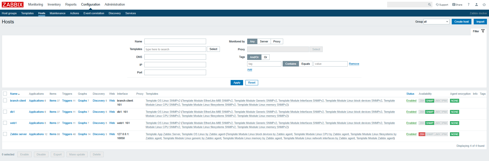
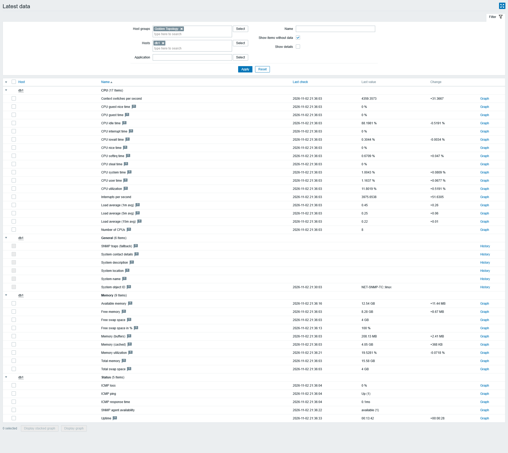
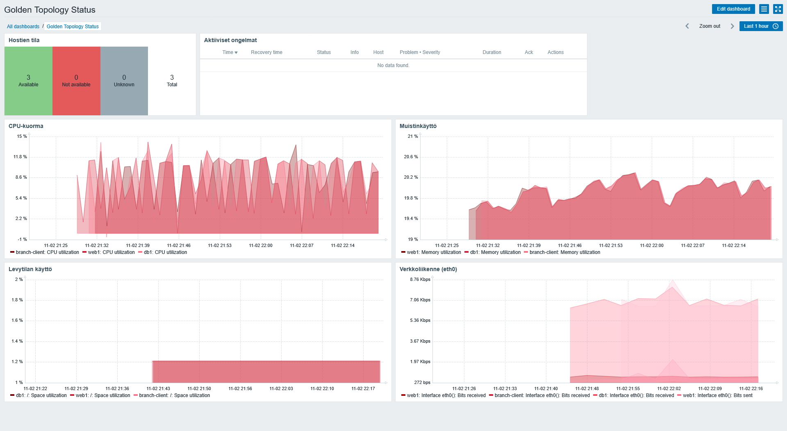
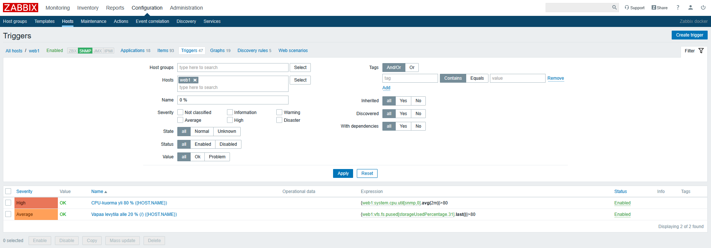
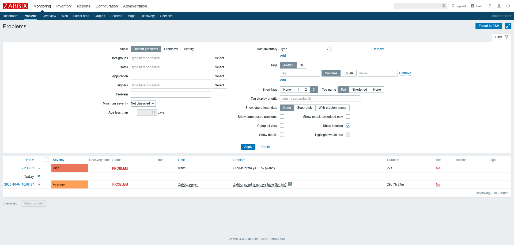
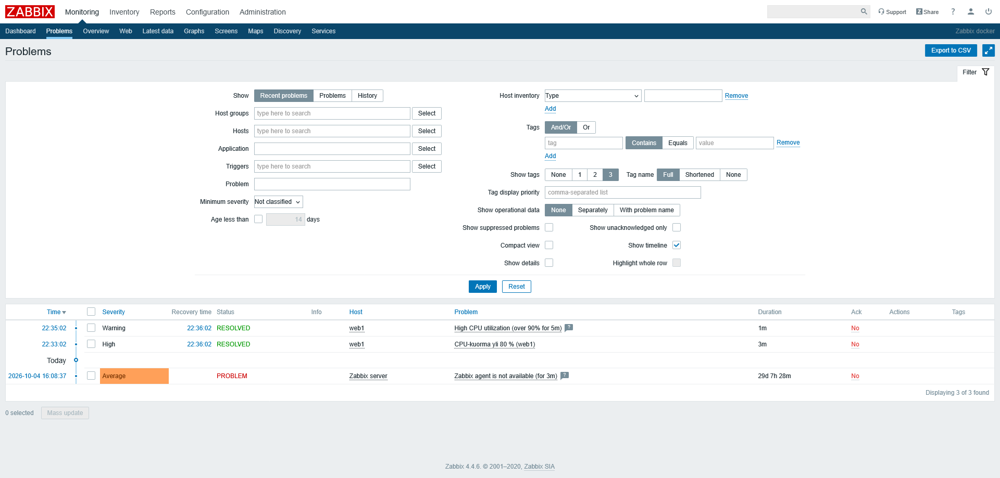
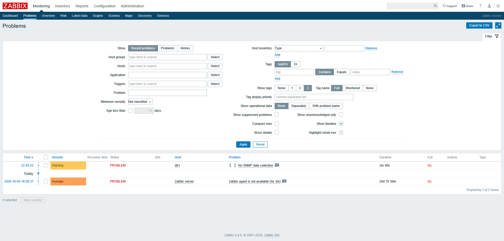
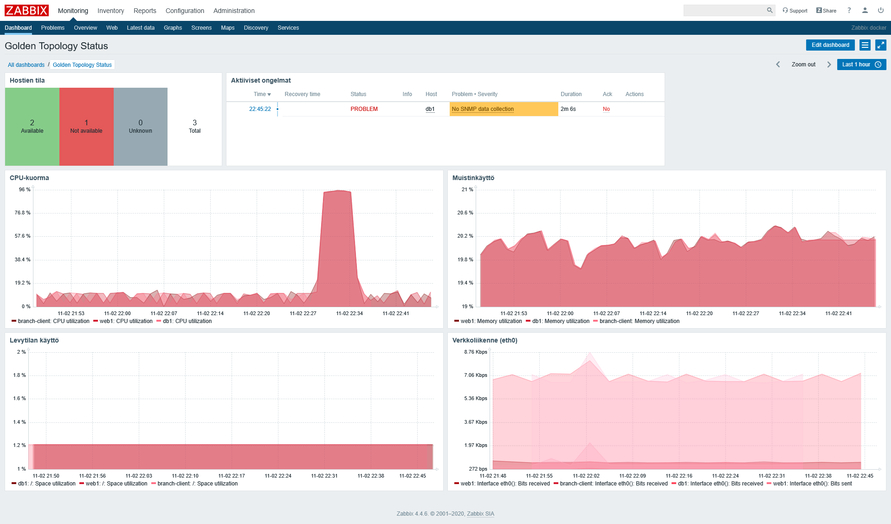
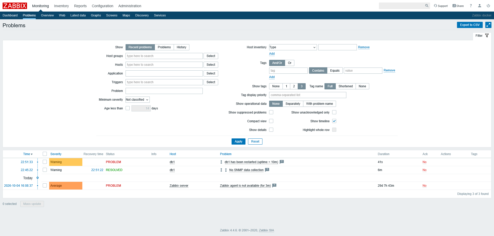

# Viikko 6: Keskitetty valvonta Zabbixilla

## 1. Johdanto

Zabbix on keskitetty valvontajärjestelmä. Zabbix-palvelin kerää mittareita valvottavilta laitteilta (agentti, SNMP, ICMP, HTTP), tallentaa ne tietokantaan ja vertaa niitä triggereihin. Kun ehto täyttyy, syntyy tapahtuma (event) ja ongelma (problem), ja actionit voivat lähettää siitä ilmoituksen. Ketju on siis host → item → trigger → event → action. Valvonta määritellään templateilla, joten samat mittarit ja triggerit saadaan kaikille saman tyyppisille laitteille kerralla.

Labrassa Zabbix pyörii Containerlab-topologian hallintaverkossa kontissa `zabbix-appliance` (palvelin, MySQL ja web-käyttöliittymä samassa kontissa), osoitteessa http://localhost:8080. Versio on **4.4.6**. Se on vanha ja tuki on päättynyt (EOL), joten käyttöliittymä poikkeaa nykyisestä 6.x/7.x-versiosta.

Ympäristö: Windows 11, WSL2 Ubuntu 24.04, Docker Engine ja Containerlab, golden-topologia.

### 6.1 Käyttöliittymä

Versiossa 4.4 valikot ovat Monitoring, Inventory, Reports, Configuration ja Administration. Tehtävän käsitteet löytyvät näin:

| Käsite | Sijainti 4.4:ssä | Mitä siellä tehdään |
|---|---|---|
| Hosts | Configuration → Hosts | valvottavien laitteiden lisäys, liitännät (agent/SNMP), host groupit ja templatet |
| Templates | Configuration → Templates | valmiit item-, trigger-, graafi- ja discovery-kokoelmat, jotka liitetään hosteihin |
| Monitoring | Monitoring → Latest data, Graphs, Overview | kerätyt arvot ja niiden historia |
| Dashboards | Monitoring → Dashboard | widgeteistä koottavat näkymät (graafit, hostien tila, ongelmat) |
| Alerts | Monitoring → Problems (avoimet ongelmat), Configuration → Actions ja Administration → Media types (ilmoitusten lähetys) | hälytysten seuranta ja ilmoitusten määrittely |
| Reports | Reports → System information, Availability report, Triggers top 100, Audit, Action log | palvelimen tila, saatavuusraportit ja lokit |

Huomio: sisäänrakennetulla hostilla "Zabbix server" on ollut kuittaamaton ongelma "Zabbix agent is not available" 4.10.2026 alkaen, koska applianceen ei ole konfiguroitu agenttia. Pitkään kuittaamatta jäävä ongelma on hälytyskohinaa, joka opettaa ohittamaan Problems-näkymän. Tuotannossa se korjattaisiin tai triggeri poistettaisiin käytöstä.

## 2. Lisätyt hostit (6.2–6.4)

| Host | Host group | Liitäntä | Template |
|---|---|---|---|
| web1 | Golden Topology | SNMPv2, DNS-nimi `web1`, portti 161, community `public` | Template OS Linux SNMPv2 |
| db1 | Golden Topology | SNMPv2, DNS-nimi `db1`, portti 161, community `public` | Template OS Linux SNMPv2 |
| branch-client | Golden Topology | SNMPv2, DNS-nimi `branch-client`, portti 161, community `public` | Template OS Linux SNMPv2 |


**Miksi SNMP eikä Zabbix-agentti:** hostien snmpd oli jo konfiguroitu viikoilla 2 ja 4 (`rocommunity public`, `agentaddress udp:161`), joten valvonta saatiin ilman uusia asennuksia. Ubuntun paketeista saatavan agentin (6.x) yhteensopivuutta 4.4-palvelimen kanssa en varmistanut. Kontit eivät käytä systemd:tä, joten snmpd käynnistettiin komennolla `service snmpd start`.

**Miksi DNS-nimi eikä IP:** hallintaverkon (172.20.20.0/24) osoitteet vaihtuvat jokaisella deployllä (tällä kertaa web1 172.20.20.14, db1 172.20.20.5, branch-client 172.20.20.10). Zabbix-kontti resolvoi solmujen nimet, joten nimet pysyvät oikeina deployn jälkeenkin.

**Discovery:** jokaiselle hostille tuli aluksi 37 itemiä ja low-level discoveryn jälkeen 89–93 (branch-client 89, db1 ja web1 93). Template OS Linux SNMPv2 on kooste, joka linkittää moduulit EtherLike-MIB, Generic, Interfaces, Linux block devices, Linux CPU, Linux filesystems ja Linux memory (kaikki SNMPv2). Discovery löysi levyt sda–sdd, tiedostojärjestelmät (`/` ja bind mountit) ja verkkoliitännät eth0 ja eth1 (10 itemiä kumpaankin). Liitäntä lo suodatetaan pois makrolla `{$NET.IF.IFNAME.NOT_MATCHES}`.

Ongelmat ja ratkaisut:
- Discovery-sääntöjen oletusväli on 1 h, joten osa itemeistä puuttui aluksi. Kun valitsin kaikki säännöt ja painoin Check now, tuli virhe "Cannot send request: wrong discovery rule type". Syy: CPU discovery on Dependent item, jota ei voi ajaa erikseen. Network interfaces discovery piti avata ja ajaa yksinään (Check now).
- EtherLike-MIB Discovery näyttää virheen "no value received for macro {#SNMPVALUE}". Se on harmiton, koska konttien veth-liitännät eivät tue EtherLike-MIBiä.





## 3. Dashboard (6.6)

Loin dashboardin **Golden Topology Status** (aikaväli Last 1 hour):

| Widget | Tyyppi | Sisältö |
|---|---|---|
| Hostien tila | Host availability | SNMP-saatavuus, 3/3 Available |
| Aktiiviset ongelmat | Problems | avoimet ongelmat |
| CPU-kuorma | SVG graph | CPU utilization, hostit web1, db1, branch-client |
| Muistinkäyttö | SVG graph | Memory utilization |
| Levytilan käyttö | SVG graph | /: Space utilization |
| Verkkoliikenne (eth0) | SVG graph | Interface eth0(): Bits received / sent |

SVG graph -widgeteissä host pattern sisältää kaikki kolme hostia, joten yksi widget näyttää ne rinnakkain.



## 4. Mittarit ja niiden merkitys (6.5)

Arvot haettiin Zabbixin API:sta (`/api_jsonrpc.php`) skriptillä [week06-metrics.py](week06-metrics.py) ja koko tuloste on tiedostossa [week06-metrics.txt](week06-metrics.txt). Taulukon arvot ovat web1:ltä.

| Mittari | Arvo | Merkitys |
|---|---|---|
| CPU utilization | 11,79 % | Prosessorin käyttöaste. Pitkään korkea arvo hidastaa palveluja ja kertoo kapasiteetin loppumisesta tai karanneesta prosessista. |
| Load average (1m avg) | 0,37 | Suoritusta odottavien prosessien määrä. Kun se ylittää ytimien määrän (8), kone on ylikuormitettu. |
| Memory utilization | 20,10 % | Muistin käyttö. Muistin loppuessa kone alkaa swapata tai OOM killer lopettaa prosesseja. |
| Uptime | 2915 s | Agentin käyntiaika. Äkillinen nollautuminen kertoo uudelleenkäynnistyksestä. |
| /: Space utilization | 1,21 % | Juuritiedostojärjestelmän täyttöaste. Täysi levy kaataa tietokannan ja estää lokien kirjoituksen. |
| Interface eth0(): Bits received / sent | 776 / 6680 bps | Hallintaverkon liikenne. Poikkeama perustasosta voi kertoa viasta tai hyökkäyksestä. |
| Interface eth1(): Bits received / sent | 56 / 0 bps | Dataverkon liikenne. Labrassa lähes nolla, koska palveluja ei käytetä. |
| ICMP response time | 0,1 ms | Verkkoviive Zabbixilta hostille. Kasvu kertoo verkon ruuhkasta tai viasta. |

Havainnot:
- CPU, muisti, levy ja kuorma ovat lähes samat kaikilla kolmella hostilla. Kontit jakavat WSL2-isännän ytimen, joten SNMP näyttää isännän resurssit, ei konttikohtaisia. Levy on noin 1 TB:n WSL2-levy, joten käyttöaste on vain 1,2 %.
- Uptime ei kerro kontin vaan snmpd-agentin käyntiaikaa (ks. kohta 6).
- eth0:n lähtevä liikenne on web1:llä ja db1:llä noin 6,6 kbps, mutta branch-clientillä vain 600 bps. Todennäköisin syy on, että Prometheus kerää web1:n ja db1:n Node Exporterilta mittareita (viikko 3). Tätä en ole varmistanut.
- SNMP tuo mukaan myös `/`-overlay-tiedostojärjestelmän, jota Node Exporter ei viikolla 3 näyttänyt oletussuodattimilla.
- CPU-graafi heiluu 0–14 %:n välillä, koska arvo on minuutin välein otettu hetkellinen näyte.

## 5. Triggerit (6.7)

Loin web1:lle kaksi omaa triggeriä:

| Nimi | Ehto | Vakavuus |
|---|---|---|
| CPU-kuorma yli 80 % ({HOST.NAME}) | `{web1:system.cpu.util[snmp,0].avg(2m)}>80` | High |
| Vapaa levytila alle 20 % (/) ({HOST.NAME}) | `{web1:vfs.fs.pused[storageUsedPercentage.31].last()}>80` | Average |

- CPU-triggeri käyttää 2 minuutin keskiarvoa, jotta yksittäinen piikki ei laukaise hälytystä.
- Levytriggeri vertaa käyttöastetta, koska "vapaa alle 20 %" tarkoittaa samaa kuin "käytössä yli 80 %".



## 6. Hälytys- ja häiriötestit

### 6.8 CPU-kuormitus

`yes > /dev/null` kuormitti vain yhtä ydintä kahdeksasta (noin 12,5 %), joten käytin web1:ssä komentoa `stress-ng --cpu 8`. Tuloste on tiedostossa [week06-cpu-test.txt](week06-cpu-test.txt).

| Aika | Tapahtuma |
|---|---|
| 22:29:53 | kuormitus alkoi |
| 22:33:02 | oma trigger "CPU-kuorma yli 80 %" PROBLEM (High), 3 min 9 s alusta |
| 22:35:02 | templaten trigger "High CPU utilization (over 90% for 5m)" PROBLEM (Warning) |
| 22:35:11 | kuormitus päättyi |
| 22:36:02 | molemmat RESOLVED, 51 s kuorman päättymisestä |

Viive selittyy näin: 2 minuutin keskiarvon täytyy ensin nousta yli 80 %:n ja lisäksi arvo kerätään kerran minuutissa. Templaten trigger vaatii 5 minuuttia, joten se laukesi vasta myöhemmin.

Templaten trigger laukesi vain web1:lle, vaikka graafien mukaan kuorma näkyi kaikilla hosteilla (sama WSL2-isäntä). Syytä en saanut varmistettua.





**Levytriggeriä ei voitu testata.** Levy on noin 1 TB ja siitä on käytössä 1,2 %. 80 %:n raja olisi vaatinut noin 800 Gt:n kirjoittamisen, mikä ei ole järkevää kotikoneella.

### 6.9 Palvelun pysäytys

Pysäytin db1:n SNMP-agentin, jonka kautta Zabbix kerää kaiken datan. Ajat ovat tiedostossa [week06-outage-test.txt](week06-outage-test.txt).

```
docker exec clab-hamk-verkonhallinta-golden-db1 service snmpd stop
docker exec clab-hamk-verkonhallinta-golden-db1 service snmpd start
```

| Aika | Tapahtuma |
|---|---|
| 22:38:55 | snmpd pysäytetty |
| ennen 22:44 | Hostien tila -widget: db1 Not available, mutta ei ongelmaa |
| 22:45:22 | ongelma "No SNMP data collection" (Warning), 6 min 27 s pysäytyksestä |
| 22:50:05 | snmpd käynnistetty |
| 22:51:22 | "No SNMP data collection" RESOLVED, 1 min 17 s käynnistyksestä |
| 22:51:33 | uusi ongelma "db1 has been restarted (uptime < 10m)" (Warning) |
| 23:01:03 | "db1 has been restarted" RESOLVED, 10 min 58 s snmpd:n käynnistyksestä |

Havainnot:
- **Saatavuus ja ongelma ovat eri asioita.** Zabbix merkitsi db1:n SNMP-saatavuuden punaiseksi nopeasti, mutta saatavuus on hostin tila eikä trigger. Siitä ei synny eventiä eikä hälytystä. Ongelma syntyi vasta templaten triggeristä, joka odottaa noin 5 minuuttia ilman SNMP-dataa.
- **Ping ei hälyttänyt**, koska kontti oli pystyssä ja vastasi ICMP:hen. Zabbix erotti tilanteen "palvelu kaatui" tilanteesta "host on alhaalla".
- **Toipuminen havaittiin nopeammin kuin vika**, koska ensimmäinen onnistunut kysely palauttaa triggerin.
- **Väärä hälytys:** "db1 has been restarted" laukesi, vaikka db1 ei käynnistynyt uudelleen. Uptime-mittari kertoo snmpd:n käyntiajan ja agentin uudelleenkäynnistys nollasi sen. Hälytys on vain niin luotettava kuin mittari, johon se perustuu. Ongelma korjaantui itsestään klo 23:01:03, kun seuraava uptime-arvo ylitti 10 minuuttia (raja ylittyi noin klo 23:00:05 ja arvo kerätään kerran minuutissa).
- Noin 6,5 minuutin viive on pitkä kriittiselle palvelulle. Viivettä voisi lyhentää pienentämällä templaten aikaikkunaa, mutta silloin lyhyet katkot aiheuttaisivat enemmän turhia hälytyksiä.







## 7. Vertailu: SNMP, Prometheus ja Zabbix (6.10)

| Ominaisuus | SNMP | Prometheus | Zabbix |
|---|---|---|---|
| Tiedonkeruu | Protokolla, ei järjestelmä. Manageri kysyy agentilta (poll) MIB-puun OID-arvoja ja agentti voi lähettää trapeja. | Pull: palvelin hakee HTTP:llä exportereilta (esim. Node Exporter) tekstimuotoisia mittareita. | Agentti (passiivinen tai aktiivinen), SNMP, ICMP, HTTP, IPMI ja JMX. Käyttää SNMP:tä yhtenä keruutapana. |
| Dashboardit | Ei omia. Tarvitsee erillisen työkalun. | Perusgraafit, käytännössä Grafana (viikko 3). | Sisäänrakennetut dashboardit, graafit, kartat ja Host availability -widget. |
| Hälytykset | Trapit agentilta, ei logiikkaa. | PromQL-säännöt ja erillinen Alertmanager. | Triggerit, vakavuustasot, eventit, actionit, kuittaukset ja eskalointi samassa järjestelmässä. |
| Käyttöönotto | Agentti on valmiina useimmissa verkkolaitteissa. Konfigurointi on yksinkertaista, mutta MIBit ovat vaikeaselkoisia. | Konfiguraatio YAML-tiedostoissa, sopii versionhallintaan ja Ansibleen. Exporter jokaiselle kohteelle. | Web-käyttöliittymä ja valmiit templatet. Nopea aloittaa, mutta konfiguraatio on tietokannassa (API ja export saatavilla). |
| Skaalautuvuus | Pollaus kuormittaa suuria ympäristöjä. v2c:n community kulkee selväkielisenä. | Hyvä, erityisesti konttiympäristöissä (service discovery). Pitkä säilytys vaatii lisäosia. | Hyvä proxyjen avulla. Relaatiotietokanta voi olla pullonkaula suurilla datamäärillä. |
| Yrityskäyttö | Verkkolaitteiden (kytkimet, reitittimet, tulostimet) standardi. | Pilvi- ja Kubernetes-ympäristöt, DevOps-tiimit. | Perinteinen IT-infra: palvelimet, verkkolaitteet ja palvelutasoseuranta. Kaupallinen tuki saatavilla. |

Labran kokemus: Prometheus ja Grafana (viikko 3) näyttivät hyvältä ja olivat koodina hallittavissa. Zabbixissa hälytykset, ongelmien elinkaari ja hostien tila olivat valmiina samassa paikassa. SNMP oli molemmille vain keruutapa.

## 8. Yhteenveto

### Pohdinta (6.11)

**Mitä hyötyä keskitetystä valvonnasta on?** Yksi näkymä koko ympäristöön, joten vikaa ei tarvitse etsiä kirjautumalla jokaiselle koneelle. Historia mahdollistaa trendit, kapasiteettisuunnittelun ja SLA-raportoinnin. Ongelmat havaitaan ennen kuin käyttäjä soittaa. Templateilla valvonta on yhtenäistä kaikille hosteille.

**Mitkä mittarit ovat mielestäsi tärkeimpiä?** Saatavuus (ping ja agentin saatavuus), koska muut mittarit ovat merkityksettömiä, jos kone ei vastaa. Sen jälkeen levytila, koska täysi levy kaataa palvelut äkillisesti. Seuraavina CPU ja muisti pitkän aikavälin keskiarvoina sekä verkkoliikenne perustason poikkeamien havaitsemiseen. Tärkeintä olisi kuitenkin palvelutason tarkistus, esimerkiksi web1:n HTTP-vastaus, koska se kertoo, toimiiko palvelu käyttäjälle.

**Millaisista tilanteista ylläpitäjän pitäisi saada hälytys?** Heti: host tai palvelu ei vastaa, levy täyttymässä, tietokanta alhaalla tai epäilyttävä tietoturvatapahtuma. Hälytyksen pitää vaatia toimenpidettä. Pitkäkestoinen korkea CPU-kuorma tai muistinkäyttö kannattaa näyttää Warning-tasolla. Testeistä opin, että pelkkä raja-arvo ei riitä. Väärä restart-hälytys ja kuukauden kuittaamaton Zabbix server -ongelma ovat esimerkkejä kohinasta, joka heikentää luottamusta hälytyksiin.

**Missä tilanteissa käyttäisit Prometheusta?** Kontti- ja Kubernetes-ympäristöissä, joissa kohteet syntyvät ja häviävät jatkuvasti ja service discovery on tärkeää. Myös sovellusmittareiden keruussa ja silloin, kun konfiguraatio halutaan versionhallintaan ja automaatioon (Ansible, GitOps).

**Missä tilanteissa käyttäisit Zabbixia?** Perinteisessä yritysverkossa, jossa on palvelimia ja verkkolaitteita (SNMP) ja tarvitaan valmiit templatet, hälytysten elinkaari, kuittaukset ja raportit yhdessä järjestelmässä. Sopii myös ylläpitotiimille, joka käyttää mieluummin käyttöliittymää kuin konfiguraatiotiedostoja.

**Mitä valvontatoimintoja lisäisit tähän ympäristöön?**
- HTTP-tarkistus web1:lle (Web scenario) ja MySQL-tarkistus db1:lle, jotta valvottaisiin palvelua eikä vain hostia.
- Reitittimien valvonta SNMP:llä (liitännät, BGP/OSPF-naapuruudet).
- Actionit ja ilmoitukset (sähköposti tai Teams), koska nyt ongelmat näkyvät vain käyttöliittymässä.
- Zabbix-agentti konttikohtaisiin mittareihin, koska SNMP näyttää WSL2-isännän resurssit.
- SNMPv3 v2c:n tilalle, koska `public`-community kulkee selväkielisenä (viikon 5 havainto).
- Lokien ja tietoturvatapahtumien keruu SIEM-tyyppisesti.
- Zabbixin päivitys tuettuun versioon.

### Keskeiset opit

Kurssi rakentui kerroksittain:
- Viikolla 2 opettelin SNMP:n.
- Viikolla 3 rakennettiin Prometheus- ja Grafana-valvonta.
- Viikolla 4 konfiguraatiota automatisoitiin Ansiblella.
- Viikolla 5 analysoitiin protokollia Wiresharkilla.
- Viikolla 6 Zabbix kokosi nämä yhteen: se käytti viikoilla 2 ja 4 konfiguroitua snmpd:tä ja sen tuloksia voi verrata viikon 3 Prometheus-valvontaan.

Tärkein oppi oli, että valvonta ei ole pelkkä graafi vaan ketju mittarista hälytykseen ja toimenpiteeseen. Ketjun jokaisessa kohdassa on valintoja: mittarin luotettavuus (uptime oli agentin eikä hostin), havaitsemisviive (6,5 min) ja hälytyskohina. Lisäksi konttiympäristö ei ole sama asia kuin fyysinen palvelin, sillä resurssimittarit näyttivät isännän eivätkä kontin arvoja.